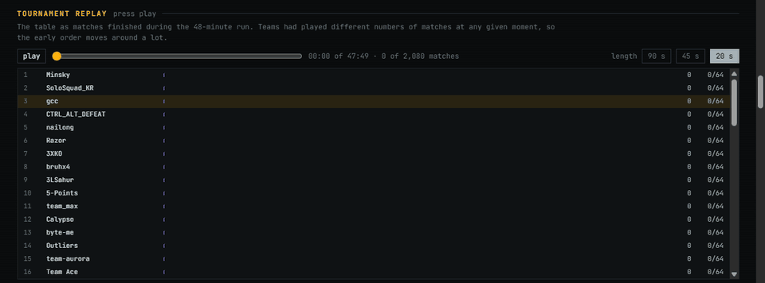
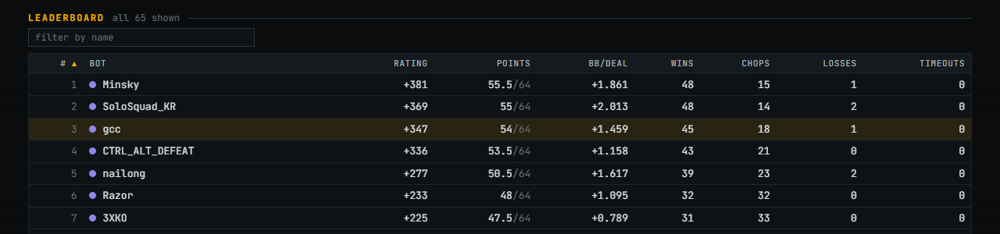
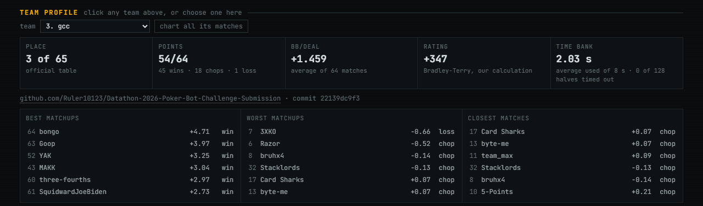
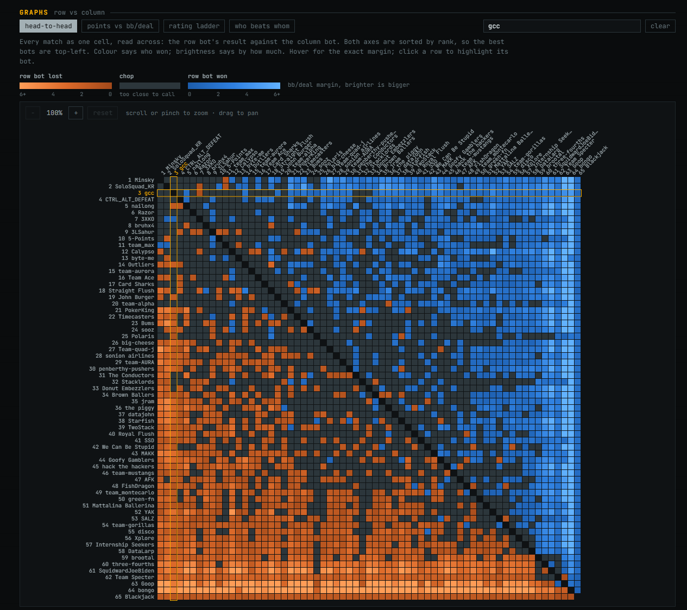
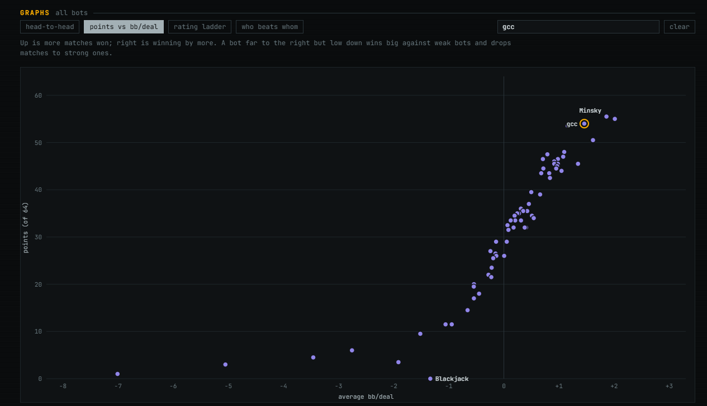
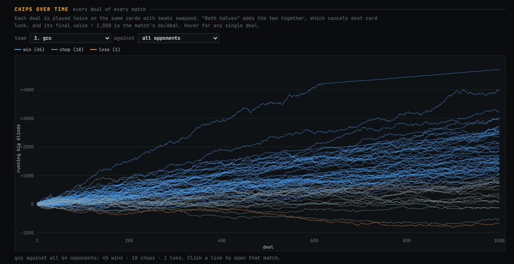
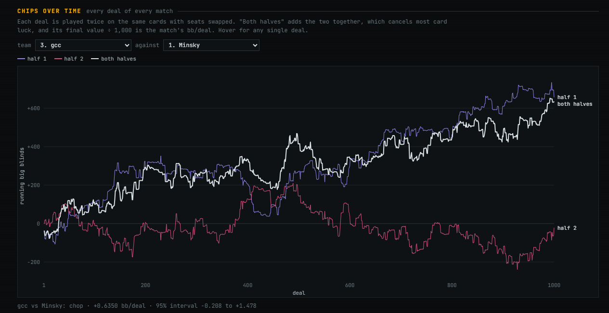
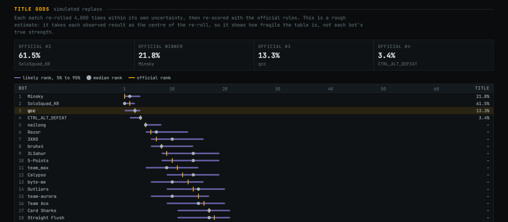

# Po: 3rd place, TAMU Datathon 2026 Poker Bot Challenge

**Team gcc · bot "Po" · 3rd of 65 teams** in the official round robin of heads-up Short Deck 5-card Pot-Limit Omaha bots.



## The team

Po was built by four people:

- **Sean Hau Goh** ([Devpost](https://devpost.com/Ruler10123))
- **Abraham Lira** ([Devpost](https://devpost.com/Abraham001l))
- **Jadon Lee** ([Devpost](https://devpost.com/JadonLee8))
- **Alexander Bui** ([Devpost](https://devpost.com/zanbowie138))

> **About this repository:** this is the submission-only copy. The tournament built one commit of a
> public repo, so we moved the finished bot here from our team's working repository, where the research,
> training, evaluation and most of the commits happened. The history here is short, but the work behind it
> belongs to the whole team. Placing 3rd took all four of us, and it wouldn't have happened without
> Abraham, Jadon and Alexander.

- **Devpost:** [Po](https://devpost.com/software/po-z9uagx)
- **Official results (interactive):** [datathon2026-vpni.onrender.com/tournament.html](https://datathon2026-vpni.onrender.com/tournament.html)
- **Commit that played:** [`22139dc`](https://github.com/Ruler10123/Datathon-2026-Poker-Bot-Challenge-Submission/commit/22139dc9f3)

## Result



| | |
|---|---|
| Place | **3 of 65** |
| Points | **54 / 64** (win = 1, chop = ½) |
| Matches | 45 wins · 18 chops · **1 loss** |
| Average margin | +1.459 big blinds per deal over 64 matches |
| Time bank | 2.03 s used on average of the 8 s per half · 0 of 128 halves timed out |
| Errors / forfeits | 0 |

Every match is 1,000 deals played twice on the same cards with the seats swapped. A win needs the whole 95%
confidence interval of the margin above zero, so close matches end as chops.

- **Against the two teams above us:** both matches were chops. We were ahead of first-place Minsky by
  +0.64 bb/deal, but not by enough to count as a win.
- **Only loss:** against 3XKO, by 0.66 bb/deal.
- **What decided the top 3:** Minsky and SoloSquad_KR each won 48 matches to our 45, so they turned 3 more
  close matches into wins. The top four finished within 2 points of each other. The site's re-simulation
  of every match gives us a 13.3% chance of finishing first.



## How Po plays

Po is a game-theory bot. It doesn't search or simulate during a match: everything is solved offline and
shipped as strategy tables, so each decision is a table lookup. In the tournament that came to about 2 s of
the 8 s time bank per 1,000-hand half.

1. **The exact betting tree.** With only four actions (fold, check/call, half-pot raise, pot raise), a cap
   of 4 raises per street and stacks that reset every hand, the full betting tree is small: 62 / 810 /
   3,678 / 11,402 decision points on preflop / flop / turn / river. We keep it exact, with no bet-size
   simplification.
2. **Card abstraction.** Cards are what make the game big. Preflop hands are grouped losslessly into their
   19,998 suit-equivalence classes. On the flop, turn and river, hands are clustered into 128 buckets each
   by how their strength is distributed over the remaining cards.
3. **A blueprint from Monte Carlo CFR.** Counterfactual regret minimization, run over that abstract game,
   converges toward an equilibrium: a strategy that is hard to exploit. This is the safe fallback strategy
   (`blueprint.npz`).
4. **A response to the field.** An equilibrium only breaks even against weak opponents instead of punishing
   their mistakes. So we recorded how real competitor bots play from their public repos (about 917,000 of
   their decisions), built a model of that field, and trained a data-biased response (DBR) against it. The
   result keeps much of the blueprint's safety while taking more from the field's typical leaks.
   This is the main strategy (`strategy.npz`).
5. **Switching during a match.** Po scores every opponent action by how likely it is under the blueprint
   versus under the field model. If an opponent looks like an equilibrium player, Po switches to the
   blueprint, where the exploitative strategy would give chips back. If it looks like a cluster of very
   aggressive bots, Po switches to a third strategy trained for that cluster (`c1.npz`). Hysteresis stops
   it from flip-flopping.

We picked this build out of dozens of candidates using our own evaluation harness: duplicate matches with
fixed seeds, a pool of style bots, every public competitor bot we could find, multi-seed runs, and a full
check in the real tournament Docker image under the real limits.

## The tournament in graphs

All of these are from the [official results page](https://datathon2026-vpni.onrender.com/tournament.html),
with gcc highlighted.

**Every match, row bot against column bot** (blue = row bot won, orange = row bot lost, grey = chop):



**Points against average margin.** Up means more matches won, right means winning by more:



**Po's 64 matches, chips over time:**



**Against the winner, Minsky** (a chop at +0.64 bb/deal):



**How fragile the top of the table is.** Every match re-rolled 4,000 times within its own uncertainty:



## What's in this repo

| Path | What it is |
|---|---|
| `agent.py` | The organizers' FastAPI server template. Our only edits are the team/bot names and one import of `bot/policy.py`. |
| `bot/policy.py` | Po's policy (`new_half`, `choose_action`, `on_hand_end`) with our shared helpers inlined. Never lets an exception escape. |
| `bot/abstraction.npz` | The card abstraction: bucket tables for each street. |
| `bot/blueprint.npz` | The MCCFR blueprint (the safe strategy). |
| `bot/strategy.npz` | The DBR response to the field (the main strategy). |
| `bot/c1.npz` | The response to the aggressive cluster. |
| `bot/switch.npz`, `bot/switch_c1.npz` | Per-node action rates used to decide when to switch strategies. |
| `game.py`, `evaluator.py`, `judge_engine.py`, `baseline-bots/`, `docker/`, `tools/`, `test_agent.py` | The organizers' starter bundle, unchanged. |
| `docs/STARTER_README.md` | The organizers' original README: rules, API and submission guide. |
| `docs/img/` | Screenshots from the official results page. |

## Run it

```bash
pip install -r requirements-dev.txt
python agent.py                               # Po on port 5008
python baseline-bots/baseline_random.py       # an opponent on port 5009
python judge_engine.py --deals 1000 --seed 7  # full duplicate match
```

The tests (`python -m pytest -q`) and the Docker build check (`./tools/check_build.sh`) work as described in
[the starter guide](docs/STARTER_README.md). Po needs only numpy beyond the server stack.

## Thanks

Thanks to the TAMU Datathon team for running the challenge and to every team that published its bot: playing
against the field is what shaped Po. And once more to Abraham, Jadon and Alexander.
